# Mac Performance Monitor

[](https://github.com/Zesty0wl/mac-performance-monitor/actions/workflows/ci.yml?query=branch%3Amain)
[](https://github.com/Zesty0wl/mac-performance-monitor/releases/latest)
[](https://github.com/Zesty0wl/mac-performance-monitor/releases)
[](https://formulae.brew.sh/cask/mac-performance-monitor)
[](https://formulae.brew.sh/cask/mac-performance-monitor)
[](https://github.com/Zesty0wl/mac-performance-monitor/stargazers)

[](#install)
[](#install)
[](Package.swift)
[](#install)
[](#privacy)
[](https://crowdin.com/project/mac-performance-monitor)
[](LICENSE)
[](https://openmacapps.com/apps/mac-performance-monitor/)

A native macOS **performance monitor and recorder**. See what your Mac is doing
now, then go back to the moment a slowdown or spike began. Compare CPU, memory,
GPU, network, disk, battery, and sensor readings with the processes behind them.

Use it as a live menu bar readout, a quiet background recorder, or a window you
open when needed. The menu bar and history recorder have separate switches.

Free and open source. No usage telemetry. Recorded samples stay on your Mac.

[2.7 release notes](RELEASE_NOTES.md) · [Changelog](CHANGELOG.md) ·
[Documentation](docs/README.md)

[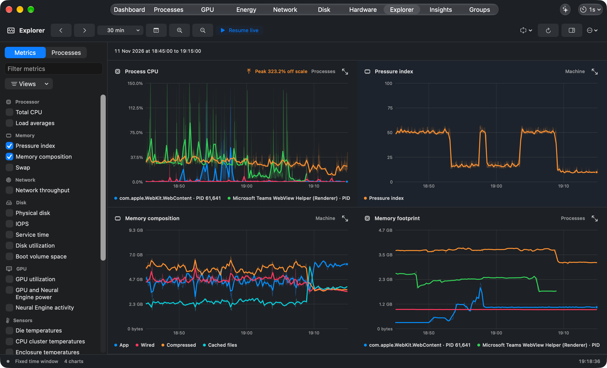](docs/images/explorer.png)

## New In 2.7

The GPU tab now shows what the GPU is doing, not just how busy it is, and
update checks no longer interrupt you.

- **Inside the GPU:** the Device panel has five pages, all read without
  administrator rights. **Clock** compares the average clock while awake with
  the chip's top clock. **Limits** shows what held the clock back and the
  performance lost. **Work** breaks down compute, fragment and geometry
  submissions. **Memory** shows the GPU's wired-memory limit and headroom.
  **Health** counts recoveries, firmware restarts, killed work and thermal
  activations. Over time gains a recorded Clock chart.

- **Quieter updates:** scheduled checks never open a window or take focus.
  When an update is ready, an **Update** button appears in the main window and
  the menu bar menus. "Check for updates automatically" and "Install updates
  automatically" in Settings > General now work.

- **Shared Macs:** everyone signed in can run the app at the same time, each
  in their own account. The privileged helper still limits standard users to
  their own processes.

See the [release notes](RELEASE_NOTES.md) for requirements and the
[changelog](CHANGELOG.md) for every change.

## Recent Releases

- **2.6:** the Processes tab's **Apps** layout adds up each app's memory and
  CPU across all of its processes, including the helpers macOS starts for it.
  Russian joins the languages. A security review tightened the privileged
  helper, force quit and the uninstaller.
  [Details](CHANGELOG.md#260---2026-11-01)

- **2.5:** Hardware > **Ports** checks every USB-C, MagSafe, HDMI and SD port,
  including cable ratings and slow chargers. The Disk page leads with a card
  for each drive, the energy menu shows where the power comes from, and
  Explorer charts fill the window. [Details](CHANGELOG.md#250---2026-10-25)

- **2.4:** in menu-only tests, idle memory fell from about 160 MiB to about
  70 MiB. The GPU tab is about half as tall.
  [Details](CHANGELOG.md#240---2026-10-17)

- **2.3:** Ask About This Mac opens with a plain status for each part of the
  Mac. The app ships `mpm`, a read-only command-line tool and MCP server for
  AI agents. Temperatures follow your Mac's unit, and alerts flag a program
  that keeps a core busy for an hour. [Details](CHANGELOG.md#230---2026-10-04)

## Explorer: Investigate A Moment

Explorer is a workspace for live and recorded data. Pick a time, add the
signals you need, and compare up to eight processes, including ones that have
exited.

Hover to move a shared cursor across the charts. Click to pin a time. Hold
**Command and scroll** to zoom around the pointer; ordinary scrolling still
moves the page. Charts fill the window, or choose how many fit on screen.

The inspector shows source values, timestamps, known bounds, and stored machine
rows. Export the visible data as CSV, or share process history in a trace file.
Older data keeps its retained resolution; zooming does not invent detail.
Hardware inventory is a current snapshot, separate from history.

[Explorer guide](docs/explorer-design.md)

## Alerts Based On Change

High swap usage alone is not a reason to warn you. The rules look for
continued growth or paging strain. They can report further worsening without
first waiting for usage to fall below an old fixed limit.

Process-growth checks reject stale readings and growth that has settled.
Modest findings stay as quiet observations, not a diagnosis of a memory leak.
A separate fast-growth check can catch runaway use without waiting 20 minutes,
and a program that keeps about a core busy for an hour is flagged too.

Click the menu bar alert badge for active issues and their evidence. Snooze an
ordinary alert for an hour, or open it in Explorer at the relevant time.
Related memory alerts share a notice, and only critical notices request sound.

[Adaptive alert rules and limits](docs/adaptive-alerts.md)

## Ask And AI Agents

On macOS 27, **Ask About This Mac** opens with a one-line verdict and a status
for each part of the Mac. Tap one, or ask a plain question such as "Why is my
Mac slow?". The app checks its own readings and history, then Apple's on-device
model explains them in everyday language, with links to the matching charts.
Nothing leaves your Mac, and the area summaries work even when Apple
Intelligence is off. Answers can still be wrong, so the facts behind each one
are a click away.

Hand a harder question to Claude Code, Codex or another agent. Ask copies a
prompt that explains the recorded history, or the one-line setup for the
bundled read-only MCP server:

```sh
claude mcp add --scope user mac-performance-monitor -- "/Applications/Mac Performance Monitor.app/Contents/MacOS/mpm" mcp
```

Run `mpm help` for the command-line tool. The [AI agents guide](docs/ai-agents.md)
covers Claude Code, Codex, Claude Desktop, Cursor and VS Code, what agents
can ask, and what leaves your Mac.

## Battery History

All six Energy cards open larger charts and explanations. Health and Cycles
show daily history over months and years, kept separate for each battery pack.
Long-term history grows from new readings with recording on.

Runtime uses macOS estimates or recent steady use. A dashed forecast stays
separate from real charge data. It assumes the same workload, not a fixed
promise of how long the battery will last.

The Accessories panel shows the battery levels macOS reports for mice,
keyboards, AirPods, and other devices. Optional low-battery alerts live in
Settings > Alerts.

[Energy guide](docs/energy-design.md)

## Upgrading From 1.x

Existing alert choices and history carry forward. The old swap threshold is
no longer used, but explicit process-memory budgets remain available. New
database fields preserve detail from new samples; they cannot restore missing
older readings.

Back up the app's data before testing a downgrade. Review the
[upgrade notes](CHANGELOG.md#upgrade-notes) and [privacy policy](SECURITY.md)
before sharing trace files, reports, or screenshots.

## Monitor Your Mac

- **Processes:** sort and filter the process table, inspect memory and CPU
  history, and check file descriptors, disk I/O, and Rosetta status.
  The **Apps** layout adds up each app's memory and CPU across all of its
  processes, including the helpers macOS starts for it. Right-click a row and choose **Usage Timeline** for sampled running history.
  Optional Apple app and media activity appears separately, with unverified
  device and foreground status. It requires Full Disk Access and a per-window
  opt-in; the app keeps these activity records in memory only.

- **Groups:** collect related apps and helpers into a group and track their
  combined footprint as a share of the Mac's memory.

- **Energy:** view battery health, charge, power flow, temperatures, fans, and
  the processes using the most energy.

- **Network:** follow download and upload rates, inspect adapters, and enable
  per-app traffic tracking to see which apps use the network.

- **Disk:** chart throughput, IOPS, and service time. Inspect drive health,
  volume space, and the processes doing the most I/O.

- **Disk Map:** scan a disk or folder, explore its space as a treemap, and find
  large or old files. Reveal items in Finder or open Quick Look.

- **GPU:** see device and per-process activity, power, memory, and thermal
  limits. The Device panel shows the GPU's clock and what limits it, its work
  mix, its wired-memory limit, and health counters such as recoveries and
  firmware restarts, with clock history in Over time. The bandwidth preview adds history beside separate ANE time and
  power, and recorded GPU memory and awake time. Recognize AI runtimes such
  as Ollama, MLX, and LM Studio.

- **Hardware:** browse a searchable inventory of the chip, memory, displays,
  storage, and connected devices. Refresh on demand or save a report.
  **Ports** shows each USB-C, MagSafe, HDMI and SD port: what is plugged in,
  the negotiated data link, the charger's offer and live draw, the cable's
  rating from its e-marker, and plain-language warnings such as a cable that
  limits charging or a USB 3 drive stuck at USB 2 speed. The USB devices on
  each port are listed under it, nested by hub.

- **History and diagnostics:** choose recording detail and retention, find top
  consumers over time, and investigate processes with on-device diagnostics.

## Screenshots

Every screenshot shows real readings from one MacBook Pro (M3 Pro) running
the app, with no sample data. Hostnames, network and hardware addresses,
serial numbers, and personal device and volume names are covered with grey
boxes. Capture details are in the [release checklist](docs/release-checklist.md).

### Dashboard

The current overview: pressure, memory, CPU, network, disk, and thermal trends.

[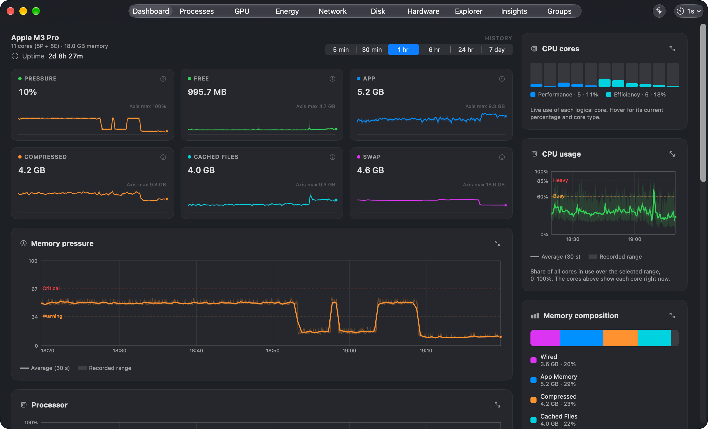](docs/images/dashboard.png)

### Processes

The Apps layout adds up each app's memory and CPU across all of its processes.
Selecting an app lists the processes working for it.

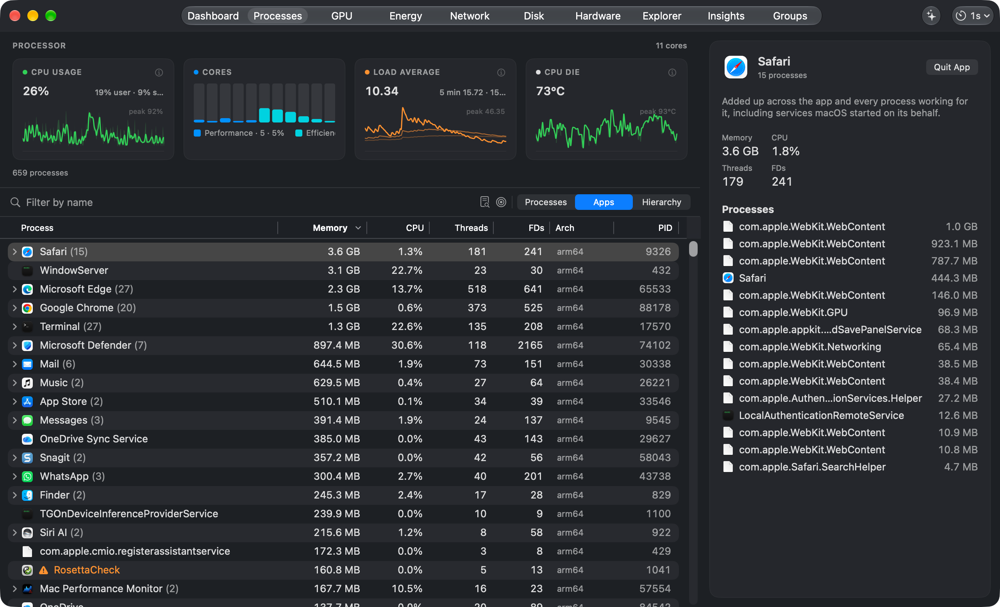

### Process Usage Timeline

Sampled running history for one process over 24 hours. Apple app and media
activity are optional lanes, left off here.

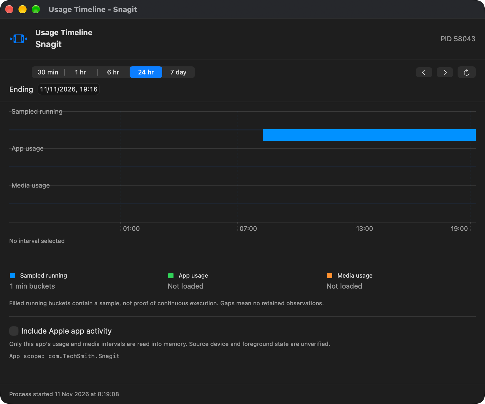

### Ask About This Mac

On macOS 27, Ask opens with a plain status for each part of the Mac, based on
the last hour.

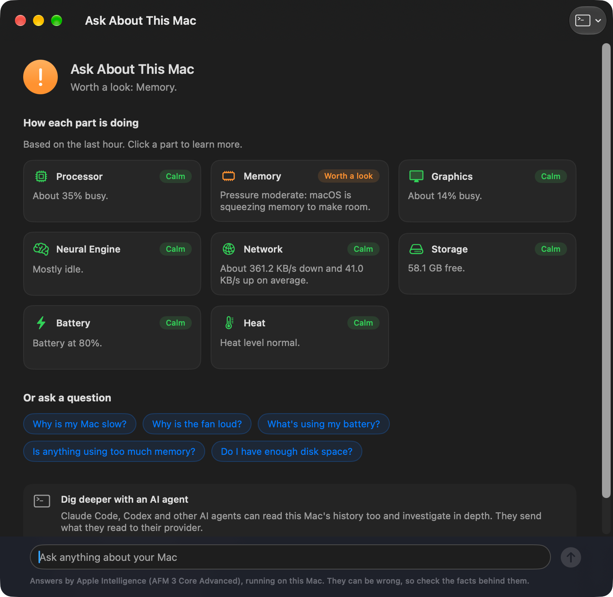

### Energy

Charge, power draw, battery health and cycles, accessory batteries, and the
processes drawing the most power.

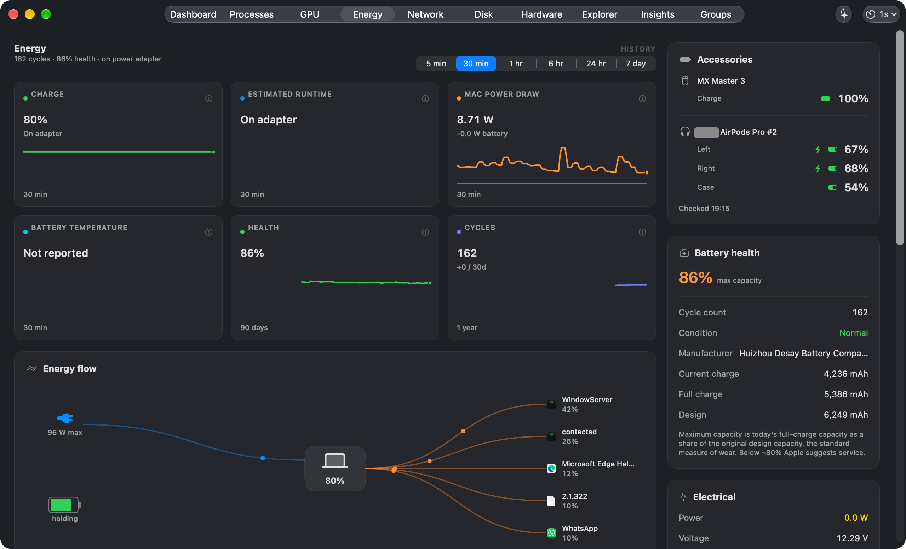

### GPU

Live GPU, power, memory, awake time and Neural Engine readings, with the
processes using the GPU and what kind of work they do.

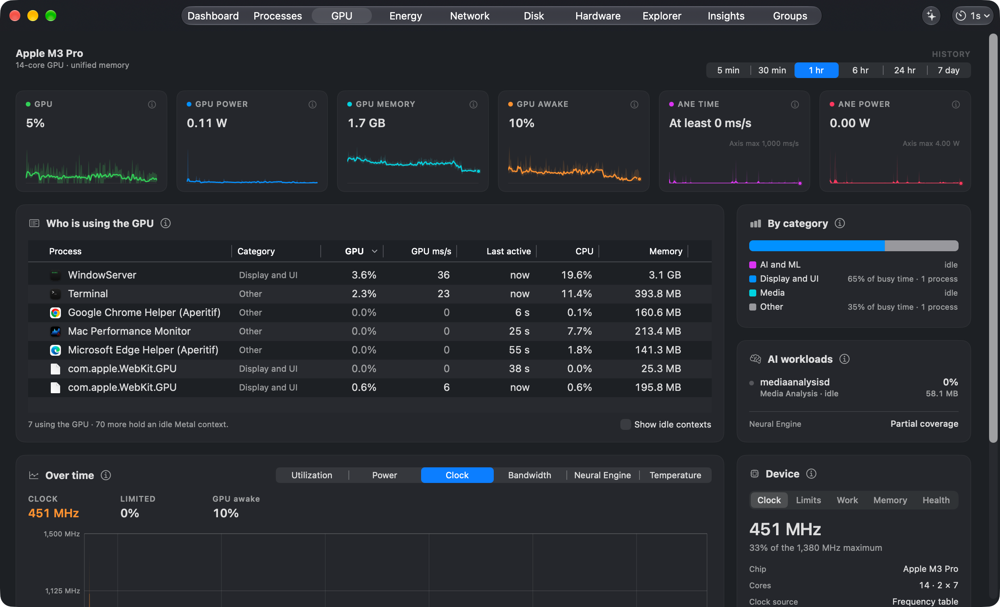

The Device panel shows the GPU's clock against its top clock and time at each
clock state, with the clock recorded in Over time.

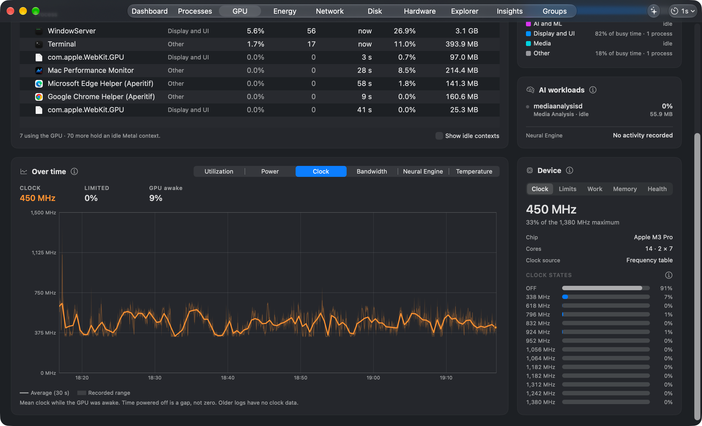

### Network

Throughput history and each network adapter.

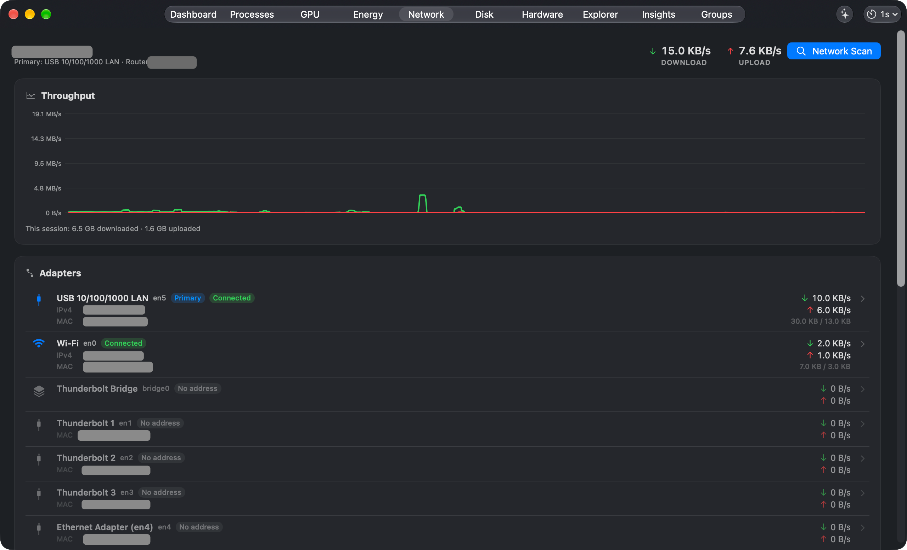

### Disk

A card for each drive with free space, connection, and live reads and writes,
beside the internal drive's health.

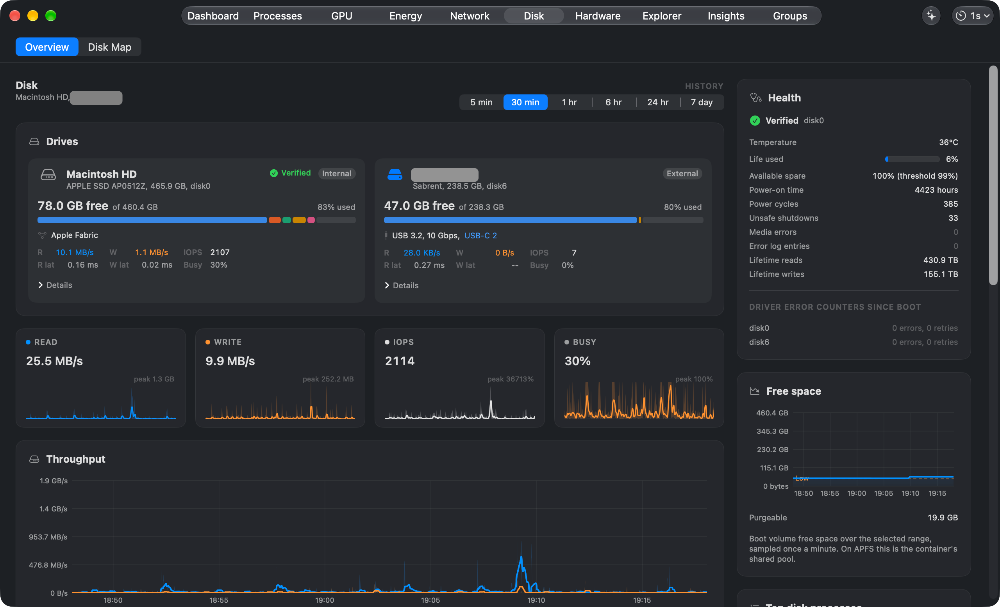

### Hardware Ports

Each port shows what is plugged in, the negotiated data links, and plain
diagnostics.

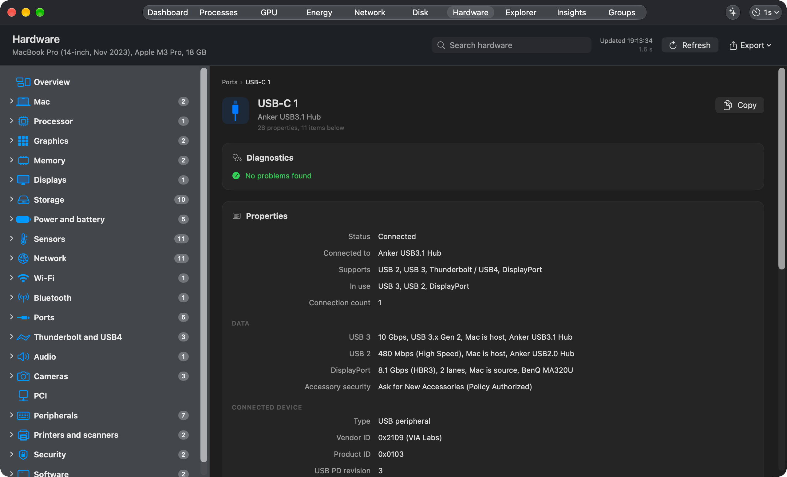

## Install

For the latest published build, download `MacPerformanceMonitor.pkg` from
[Releases](https://github.com/Zesty0wl/mac-performance-monitor/releases/latest)
and double-click it. Published packages are Developer ID signed and notarized
by Apple. Sparkle handles app updates.

### Homebrew

```sh
brew install --cask mac-performance-monitor
```

This installs the same signed, notarized pkg from the main
[homebrew-cask](https://github.com/Homebrew/homebrew-cask) repository. Homebrew's
version can lag a new release until its cask update lands. The app also keeps
itself current through Sparkle.
To include it in `brew upgrade`, pass `--greedy`.

### Build From Source

```sh
git clone --branch main https://github.com/Zesty0wl/mac-performance-monitor.git
cd mac-performance-monitor
swift build
swift test
Scripts/run.sh
```

You need Apple silicon and macOS 15 (Sequoia) or later. Building the app
bundle needs Xcode 27 for its App Intents metadata and the macOS 27 SDK. Core
builds and tests use Swift 6. Bundling needs Xcode's `xcstringstool` too.
The run script uses a signing identity when available, or falls back to ad-hoc
signing. Ad-hoc builds cannot use the privileged helper. See
[CONTRIBUTING.md](CONTRIBUTING.md) for signing options and test coverage.

## Privacy

No usage telemetry or analytics. Recorded performance data and alert evidence
stay on your Mac. Exports leave it only when you choose to share them.

Update checks, signed check and glossary downloads, and network tools make
network requests. They do not upload your recorded performance history.
Ask uses Apple's on-device model and clears its conversation when closed. If you hand an
investigation to an AI agent such as Claude Code, the agent sends what it reads
to its provider. Optional Siri
and Shortcuts sharing follows Apple's processing rules and can pass results
to other actions. See [Security and privacy](SECURITY.md) for these separate choices.

## Contributing

Contributions are welcome. See [CONTRIBUTING.md](CONTRIBUTING.md) and the
[Code of Conduct](CODE_OF_CONDUCT.md). Security reports go through
[SECURITY.md](SECURITY.md).

The app ships in English, Simplified Chinese, German, French, and Russian.
German, French, and Russian began as AI translations and await review by
native speakers. New 2.0 strings in Simplified Chinese also include generated copy awaiting review.
Translate or review in your browser on
[Crowdin](https://crowdin.com/project/mac-performance-monitor), or edit one file and open a
pull request. See [TRANSLATING.md](TRANSLATING.md) for the translation history
and review process.

## License

Released under the [MIT License](LICENSE). Bundles
[GRDB.swift](https://github.com/groue/GRDB.swift) (MIT) and
[Sparkle](https://sparkle-project.org) (MIT).
